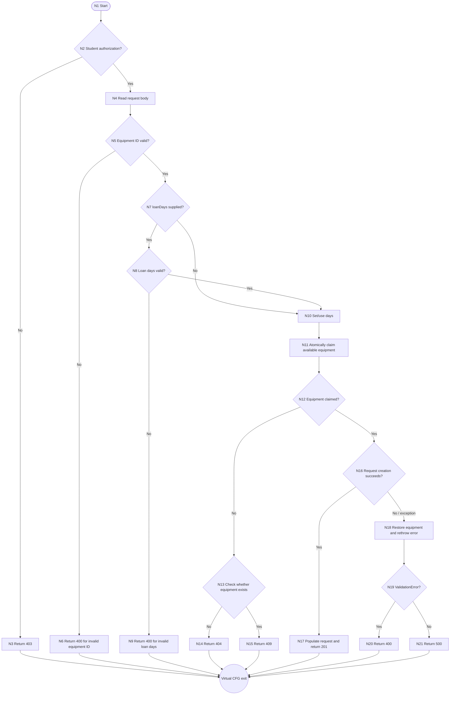

# createRequest() White-Box Analysis

## 1. Purpose

`createRequest()` was selected because it contains important LabReserve business logic in one small function. It checks student authorization, validates the equipment ID and loan days, claims equipment atomically, handles unavailable equipment, creates a request, and restores equipment when request creation fails. These branches make it a suitable EC4206 white-box analysis target without requiring a large or complex unit.

## 2. Source Under Test

| Item | Details |
|---|---|
| File | `server/controllers/requestController.js` |
| Function | `createRequest()` |
| Description | Validates a student request, claims available equipment, creates a pending request, and returns an appropriate HTTP response. |

The function uses `studentOnly()` and `isValidId()`, performs an atomic `findOneAndUpdate()` on available equipment, and rolls the equipment back to `AVAILABLE` if request creation fails.

## 3. CFG Scope and Modelling Assumptions

1. The CFG represents the control flow of `createRequest()`.
2. External library/database internals are not expanded.
3. Helper functions such as `studentOnly()` and `isValidId()` are treated at the level of their result/decision rather than expanding their internal implementation.
4. The compound loan-days validation expression is treated as one high-level decision: **“Are loanDays valid?”**
5. This is an EC4206-level white-box exercise; condition-level/MC/DC analysis is outside the current scope unless later required by the lecturer.

The source has several response returns. Therefore, `N22` below is a **virtual CFG exit** used only to join completed paths for formal graph calculation. It is not an additional application statement. The agreed source-oriented nodes are `N1`–`N21`.

## 4. Final CFG



`N16` represents successful completion versus an exception from the request-creation section. In the actual source, the inner `try` also includes population of the created request, so an exception from that population query follows the same rollback path.

## 5. Node Table

| Node | Description |
|---|---|
| N1 | Start |
| N2 | Check whether the authenticated user is a student |
| N3 | Return HTTP 403 for non-student access |
| N4 | Read `equipmentId` and `loanDays` from the request body |
| N5 | Check whether an equipment ID was supplied and is valid |
| N6 | Return HTTP 400 for an invalid equipment ID |
| N7 | Check whether `loanDays` was supplied |
| N8 | Check whether supplied loan days are an integer from 1 to 14 |
| N9 | Return HTTP 400 for invalid loan days |
| N10 | Use the supplied days or the default of 7 |
| N11 | Atomically claim equipment whose status is `AVAILABLE` |
| N12 | Check whether the equipment claim succeeded |
| N13 | Check whether the equipment exists after a failed claim |
| N14 | Return HTTP 404 when equipment does not exist |
| N15 | Return HTTP 409 when equipment exists but is unavailable |
| N16 | Check whether request creation/population completed without an exception |
| N17 | Populate the request and return HTTP 201 |
| N18 | Restore equipment to `AVAILABLE` and rethrow the error |
| N19 | Check whether the error is a Mongoose `ValidationError` |
| N20 | Return HTTP 400 for a validation error |
| N21 | Return HTTP 500 for another error |
| N22 | Virtual common CFG exit used to join response-return paths |

## 6. Edge Table

| Edge | From | To | Condition |
|---|---|---|---|
| E1 | N1 | N2 | start |
| E2 | N2 | N3 | authorization is false |
| E3 | N2 | N4 | authorization is true |
| E4 | N3 | N22 | response returned |
| E5 | N4 | N5 | body read |
| E6 | N5 | N6 | equipment ID is invalid or missing |
| E7 | N5 | N7 | equipment ID is valid |
| E8 | N6 | N22 | response returned |
| E9 | N7 | N10 | `loanDays` is not supplied; use 7 |
| E10 | N7 | N8 | `loanDays` is supplied |
| E11 | N8 | N9 | loan days are invalid |
| E12 | N8 | N10 | loan days are valid |
| E13 | N9 | N22 | response returned |
| E14 | N10 | N11 | days selected |
| E15 | N11 | N12 | atomic claim completed |
| E16 | N12 | N16 | equipment was claimed |
| E17 | N12 | N13 | equipment was not claimed |
| E18 | N13 | N14 | equipment does not exist |
| E19 | N13 | N15 | equipment exists but is unavailable |
| E20 | N14 | N22 | response returned |
| E21 | N15 | N22 | response returned |
| E22 | N16 | N17 | request creation/population succeeds |
| E23 | N16 | N18 | request creation/population throws |
| E24 | N17 | N22 | response returned |
| E25 | N18 | N19 | equipment restored and error rethrown |
| E26 | N19 | N20 | error is a `ValidationError` |
| E27 | N19 | N21 | error is not a `ValidationError` |
| E28 | N20 | N22 | response returned |
| E29 | N21 | N22 | response returned |

The edge table corresponds to the Mermaid graph, including the virtual exit node required to model all response endpoints in one connected CFG.

## 7. Cyclomatic Complexity

Using the final CFG including the virtual exit:

- `N = 22` nodes
- `E = 29` edges
- `P = 1` connected component

Therefore:

```text
V(G) = E - N + 2P
     = 29 - 22 + (2 x 1)
     = 9
```

Cross-check using decision nodes:

```text
D = 8
V(G) = D + 1
     = 8 + 1
     = 9
```

The eight decision nodes are `N2`, `N5`, `N7`, `N8`, `N12`, `N13`, `N16`, and `N19`. If the virtual exit is omitted, the multiple response endpoints make the direct `E - N + 2P` calculation inconsistent with the `D + 1` convention. The virtual exit resolves that modelling issue; it does not represent new application logic.

## 8. Independent Paths

The calculated complexity is 9, so the following nine paths form a verified basis set under this CFG convention. Each path ends at the virtual exit for clarity.

| Path ID | Node sequence | Scenario | Expected outcome |
|---|---|---|---|
| P1 | N1-N2-N4-N5-N7-N8-N10-N11-N12-N16-N17-N22 | Student supplies valid equipment ID and valid loan days; request succeeds | HTTP 201; equipment is `REQUESTED`; request is `PENDING` |
| P2 | N1-N2-N3-N22 | Non-student attempts the operation | HTTP 403 |
| P3 | N1-N2-N4-N5-N6-N22 | Missing or invalid equipment ID | HTTP 400 |
| P4 | N1-N2-N4-N5-N7-N10-N11-N12-N16-N17-N22 | Student omits loan days; default of 7 is used | HTTP 201 |
| P5 | N1-N2-N4-N5-N7-N8-N9-N22 | Supplied loan days are outside the valid range or not an integer | HTTP 400 |
| P6 | N1-N2-N4-N5-N7-N8-N10-N11-N12-N13-N14-N22 | Equipment ID is valid but no equipment document exists | HTTP 404 |
| P7 | N1-N2-N4-N5-N7-N8-N10-N11-N12-N13-N15-N22 | Equipment exists but is not available | HTTP 409 |
| P8 | N1-N2-N4-N5-N7-N8-N10-N11-N12-N16-N18-N19-N20-N22 | Request creation/population raises a Mongoose validation error | HTTP 400; equipment is restored |
| P9 | N1-N2-N4-N5-N7-N8-N10-N11-N12-N16-N18-N19-N21-N22 | Request creation/population raises another error | HTTP 500; equipment is restored |

## 9. White-Box Test Case Plan

The first version of the tests has now been written and executed with Jest. Initial coverage has also been measured and is summarized in Section 10.

| Test ID | Path | Scenario | Expected Result | Implementation Status |
|---|---|---|---|---|
| WB-01 | P1 | Successful request with valid loan days | 201 | Implemented |
| WB-02 | P2 | Non-student access | 403 | Implemented |
| WB-03 | P3 | Invalid or missing equipment ID | 400 | Implemented |
| WB-04 | P4 | Loan days omitted | 201 using default 7 days | Implemented |
| WB-05 | P5 | Invalid loan days | 400 | Implemented |
| WB-06 | P6 | Equipment does not exist | 404 | Implemented |
| WB-07 | P7 | Equipment is unavailable | 409 | Implemented |
| WB-08 | P8 | Request validation error after claim | 400 and equipment restored | Implemented |
| WB-09 | P9 | Unexpected request creation error after claim | 500 and equipment restored | Implemented |

## 10. Coverage Meaning and Interpretation

Coverage describes which parts of the instrumented code were executed by the tests:

- **Statement coverage** measures the percentage of executable statements that ran.
- **Branch coverage** measures whether the true and false outcomes of decisions ran.
- **Function coverage** measures which functions were called.
- **Line coverage** measures the percentage of executable source lines that ran.

The reported percentages for the whole `requestController.js` file were 33.64% statements, 31.81% branches, 33.33% functions, and 35% lines. These totals include every controller function in the file, not only `createRequest()`.

The function-scoped coverage reported by Codex for `createRequest()` was 100% for statements, branches, functions, and lines. This is different from the whole-file result because the current Jest suite targets only `createRequest()` and does not execute most of the other controller functions.

The low whole-file result is therefore expected. Uncovered areas include `populateRequest()`, `getMyRequests()`, `cancelRequest()`, `getAllRequests()`, `approveRequest()`, `rejectRequest()`, `changePendingRequest()`, and `returnRequest()`.

Nine independent paths are sufficient for the selected CFG basis set, but they do not guarantee complete coverage of the entire controller file or every possible combination of compound conditions. Coverage measures execution, not correctness by itself: a covered statement can still contain a defect, and a passing test must assert the expected behaviour as well as execute the code.

## 11. Current Status

- Target function selected: **COMPLETE**
- Initial CFG: **COMPLETE**
- Formal CFG verification: **COMPLETE**; node and edge counts are consistent.
- Cyclomatic complexity: **COMPLETE**; both formulas produce 9.
- Independent path identification: **COMPLETE** under the final CFG convention.
- Test implementation: **COMPLETE**; first Jest version executed with 14 passing tests.
- Initial coverage measurement and interpretation: **COMPLETE**; whole-file coverage was reported and `createRequest()` was analysed separately.
- API automation: **NOT STARTED**
- CI: **NOT STARTED**
- SonarQube: **NOT STARTED**

## 12. Next Step

Next, decide whether to extend testing to the remaining controller functions to improve whole-file coverage.
